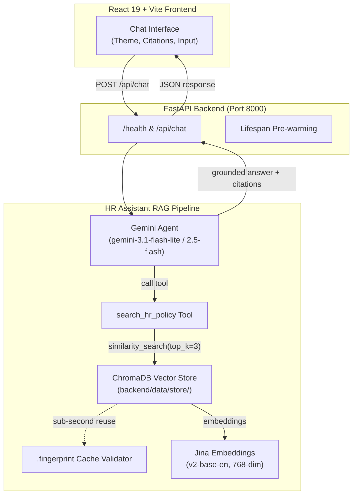

# HR Policy RAG Assistant

A production-quality Retrieval-Augmented Generation (RAG) assistant designed for enterprise HR environments. The assistant enables employees to ask questions about company HR policies contained in a PDF document and receive grounded, accurate answers backed by precise document and page-level citations.

---

## Architecture Overview

```text
HR-Policy-RAG-Assistant/
├── backend/
│   ├── hr_assistant/
│   │   ├── __init__.py          # Package exports
│   │   ├── config.py            # Pydantic Settings & environment variables
│   │   ├── document_loader.py   # PDF text extraction & metadata normalization
│   │   ├── splitter.py          # Recursive text chunking with metadata preservation
│   │   ├── embeddings.py        # Jina AI embeddings (jina-embeddings-v2-base-en)
│   │   ├── vector_store.py      # Persistent ChromaDB & fingerprint cache
│   │   ├── tools.py             # search_hr_policy LangChain retrieval tool
│   │   ├── agent.py             # Google Gemini agent with grounding & citations
│   │   └── pipeline.py          # HRAssistant pipeline & ask() interface
│   ├── app/
│   │   ├── __init__.py
│   │   ├── main.py              # FastAPI app, lifespan pre-warming, CORS
│   │   ├── routes/chat.py       # GET /health & POST /api/chat endpoints
│   │   └── schemas/chat.py      # Pydantic request/response schemas
│   ├── data/
│   │   ├── hr_policy.pdf        # Source policy PDF (208 pages)
│   │   └── store/               # Persistent ChromaDB vector storage & .fingerprint
│   ├── tests/                   # 41 unit & integration tests
│   ├── .env.example             # Environment configuration template
│   ├── .gitignore
│   └── pyproject.toml           # uv project definition
│
├── frontend/
│   ├── src/
│   │   ├── components/          # Chat, citations, input, header, theme toggle
│   │   ├── hooks/useChat.js     # Chat state & polling hook
│   │   ├── services/api.js      # Backend client service
│   │   ├── App.jsx              # Main responsive layout
│   │   └── index.css            # Tailwind v4 styles & dark mode
│   ├── package.json
│   └── vite.config.js
│
└── README.md
```



---

## Technology Stack

- **Backend Framework**: Python 3.12 with [FastAPI](https://fastapi.tiangolo.com/) and Uvicorn
- **Package Management**: [`uv`](https://docs.astral.sh/uv/) for reproducible dependency resolution
- **RAG Orchestration**: [LangChain](https://www.langchain.com/) (LangChain 1.5+, `langchain.agents.create_agent`)
- **LLM**: Google Gemini API via `langchain-google-genai` (with automated fallback across Flash models)
- **Embeddings**: Jina AI `jina-embeddings-v2-base-en` (768-dimension, 8192-token context window)
- **Vector Database**: [ChromaDB](https://www.trychroma.com/) with persistent local storage
- **PDF Parser**: `pypdf` via LangChain `PyPDFLoader`
- **Frontend**: [React 19](https://react.dev/), [Vite](https://vite.dev/), [Tailwind CSS v4](https://tailwindcss.com/), [Lucide React](https://lucide.dev/)

---

## Key Features

1. **Strictly Grounded Answers**: The agent retrieves relevant policy clauses before formulating answers and cites specific page numbers (e.g., `hr_policy.pdf, Page 21`).
2. **Honest Out-of-Policy Handling**: When queries fall outside document contents, the agent explicitly states that the policy does not contain the information and directs employees to contact HR rather than hallucinating.
3. **Adversarial Prompt Defense**: Ignores instructions inside documents or queries that attempt to override system rules, disclose keys, or compromise security.
4. **Smart Fingerprint-Based Ingestion**:
   - Computes a SHA-256 fingerprint: `SHA-256(pdf_content) + chunk_size + chunk_overlap + embedding_model`.
   - Subsequent startups reuse the existing index in **< 0.3 seconds** without re-generating embeddings.
   - Automatically detects document changes or parameter edits to trigger safe re-indexing.
5. **Modern Frontend Experience**:
   - Conversational message bubbles with user avatars and timestamps.
   - Expandable source citation drawers displaying page badges and exact text snippets.
   - Auto-growing text area with Enter-to-send support.
   - Persistent light and dark theme mode (`localStorage`).
   - Live backend health indicator and connection status banner with retry capability.
   - 4 quick-prompt starter cards for common HR topics.

---

## Getting Started

### Prerequisites

- **Python**: 3.12+
- **Node.js**: v18+ (tested on Node v24)
- **uv**: Python package manager (`curl -LsSf https://astral.sh/uv/install.sh | sh`)
- **API Keys**:
  - [Google AI Studio API Key](https://aistudio.google.com/) for Gemini
  - [Jina AI API Key](https://jina.ai/embeddings/) for embeddings

---

### Backend Setup

1. **Navigate to the backend directory**:
   ```bash
   cd backend
   ```

2. **Configure environment variables**:
   Create a `.env` file from the provided example:
   ```bash
   cp .env.example .env
   ```

   Edit `backend/.env` with your API credentials:
   ```env
   # Google Gemini API
   GOOGLE_API_KEY=your_google_ai_studio_key
   GEMINI_MODEL=gemini-3.1-flash-lite

   # Jina Embeddings API
   JINA_API_KEY=your_jina_api_key
   JINA_MODEL=jina-embeddings-v2-base-en

   # Storage & Document Paths
   HR_POLICY_PATH=data/hr_policy.pdf
   CHROMA_PERSIST_DIRECTORY=data/store

   # RAG Parameters
   CHUNK_SIZE=1000
   CHUNK_OVERLAP=200
   TOP_K=3

   # CORS
   FRONTEND_ORIGIN=http://localhost:5173
   HOST=0.0.0.0
   PORT=8000
   ```

3. **Install dependencies**:
   ```bash
   uv sync
   ```

4. **Verify Document Placement**:
   Ensure `hr_policy.pdf` is placed in `backend/data/hr_policy.pdf`.

5. **Start the FastAPI Backend**:
   ```bash
   uv run uvicorn app.main:app --host 0.0.0.0 --port 8000 --reload
   ```
   The API will be available at `http://localhost:8000`:
   - Interactive Swagger API Docs: `http://localhost:8000/docs`
   - Health check: `http://localhost:8000/health`

---

### Frontend Setup

1. **Navigate to the frontend directory**:
   ```bash
   cd frontend
   ```

2. **Install dependencies**:
   ```bash
   npm install
   ```

3. **Configure Environment (Optional)**:
   By default, the frontend connects to `http://localhost:8000`. You can configure a custom backend URL by creating `frontend/.env`:
   ```env
   VITE_API_BASE_URL=http://localhost:8000
   ```

4. **Start the Vite development server**:
   ```bash
   npm run dev
   ```
   Open `http://localhost:5173` in your browser.

---

## Running Tests

### Backend Test Suite
The backend includes 41 automated unit and integration tests covering:
- PDF document loading, metadata normalization, and corrupt/empty file handling
- Recursive text chunking and overlap verification
- Jina embeddings initialization and validation
- ChromaDB persistence, fingerprint calculation, and instant index reuse
- `search_hr_policy` LangChain tool execution and citation tracking
- Gemini agent prompt execution, grounded answers, refusals, and conversation history
- FastAPI endpoints (`/health` and `/api/chat`), CORS, and error handling

Run all backend tests:
```bash
cd backend
uv run pytest -v
```

### Frontend Linting & Build Verification
```bash
cd frontend

# Verify ESLint code quality (0 errors, 0 warnings)
npm run lint

# Build production bundle
npm run build
```

---

## API Endpoints

### 1. `GET /health`
Returns backend readiness and component status.
```json
{
  "status": "ok",
  "version": "0.1.0",
  "policy_pdf_present": true,
  "vector_store_initialized": true,
  "llm_configured": true,
  "embeddings_configured": true
}
```

### 2. `POST /api/chat`
Ask an HR policy question.

**Request Body**:
```json
{
  "message": "What is the probation period for employees?",
  "history": [
    { "role": "user", "content": "Hello" },
    { "role": "assistant", "content": "Hello! How can I help you?" }
  ]
}
```

**Response Body**:
```json
{
  "answer": "According to the IIMA HR Policy Manual 2023, the rules regarding the probation period are as follows...",
  "sources": [
    {
      "source": "hr_policy.pdf",
      "page": 69,
      "snippet": "probationary period will be such as may be determined, and on expiry of the stipulated period of probation, the employee shall be deemed to continue as a probationer..."
    }
  ],
  "policy_found": true
}
```
